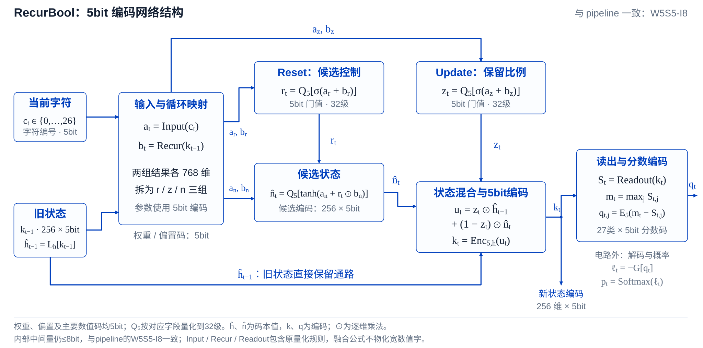

# RecurBool: Boolean Circuit Compilation Toward Photonic Recurrent Computing

**摘要**

本研究探索循环神经网络向可执行布尔逻辑电路的转换方法，提出 RecurBool，一种面向循环语言模型的精度感知逻辑电路编译框架，旨在为未来具有状态记忆与时序处理能力的光子计算架构提供可验证的逻辑表示。该框架以训练完成并冻结的门控循环单元（GRU）为基础，通过分组量化、逐维码本校准与量化误差补偿，在降低数值表示精度的同时尽可能保持原模型的预测性能。在采用 5-bit 权重与循环状态编码的基础上，RecurBool 将门控计算、非线性映射、算术运算及状态更新转换为门类型和连接关系固定的二输入布尔逻辑电路。编译后的电路保留 GRU 的门控记忆机制，可跨时间步复用，并通过自主状态反馈完成连续字符预测，无需依赖原始浮点模型。实验结果表明，在 text8 完整验证集上，RecurBool 取得 1.7436 BPC，接近原始 FP32 GRU 的 1.7116 BPC；在 WikiText-2 字节级验证中，取得 1.9165 BPB，接近原始模型的 1.8903 BPB。此外，电路实现通过了随机输入及长序列前缀的逐码一致性验证，在所检验的输入及前缀范围内验证了编译电路与相应有限精度参考计算的一致性。上述结果验证了循环语言模型向固定布尔逻辑电路转换的可行性，为进一步研究逻辑电路优化、硬件感知编译以及面向光子器件的循环计算映射提供了方法基础。

**关键词：** 循环神经网络；布尔逻辑电路；精度感知编译；低比特量化；光子计算

## RecurBool：量化校准与逻辑编译

转换包含两个阶段：

1. **量化与校准。** 仅使用训练数据确定固定尺度、状态与候选码本，并补偿部分量化误差。权重、偏置、状态、reset/update门值、候选和输出分数采用5bit编码；码本与固定尺度另计。
2. **逻辑编译。** 按有限精度规则，将乘加、比较、非线性映射、舍入和饱和展开为固定二输入单比特逻辑门。编译后门类型与连线固定，有限映射不作为不透明的运行时查表算子保留。

[查看可编辑 SVG](docs/figures/recurbool-conversion-pipeline.svg)

5bit提供32种编码。对于状态，保存的是等级编号，数值含义由对应维度的码本确定；权重则结合固定尺度解释。量化确定编码的含义，逻辑编译实现这些编码之间的有限计算。

## RecurBool：5bit编码循环网络

下面展开固定电路内部的单步网络结构。输入映射与循环映射分别产生 reset、update 和 candidate 三组分支：

- **Reset重置门**调节候选分支中的循环仿射结果，采用 reset-after-affine 结构。
- **Update更新门**决定旧状态的保留比例，以及候选内容的写入比例。
- **候选状态与状态混合**形成新的记忆，并将混合结果重新编码为5bit状态。旧状态保留一条直接参与混合的通路。
- **输出读出**由新状态产生字符分数，计算各字符分数与最大分数的差，再编码为5bit。分数解码与 Softmax 位于电路外。

[查看可编辑 SVG](docs/figures/recurbool-five-bit-network.svg)

图中 $c_t$ 表示当前字符编号，$k_t$ 表示状态编码，$q_t$ 表示输出分数编码。$\hat h_t$ 和 $\hat n_t$ 表示编码对应的状态与候选码本值；公式按这些代表值解释，编码编号不直接作为连续数值相加。`Input`、`Recur` 和 `Readout` 分别表示输入映射、循环映射和输出读出，并包含对应的量化规则。

## 数值边界与循环执行

| 对象 | W5S5-I8中的表示 |
|---|---|
| 权重、偏置、状态、门值、候选、输出 | 5bit编码 |
| 输入线性结果、乘积输出、每级树累加、循环与读出线性结果 | 不超过8bit |
| 输出最大值与分数差 | 8bit |
| carry、guard、sticky、overflow | 单比特控制信号 |
| 固定尺度、码本、指数与输出级别 | 单独记录的静态信息 |

非线性与状态混合可以在有限函数边界融合，再展开成单比特门；图中的功能公式不要求物化一个宽数值中间字。5bit编码也不等于全部存储都仅占每参数5bit，尺度和码本需要另计。

每个时间步复用同一套固定电路。电路接收当前字符与上一状态编码，产生输出分数编码和新状态编码；新状态保存后供下一步使用。循环过程反馈电路自身状态，部署时不需要教师状态注入。
