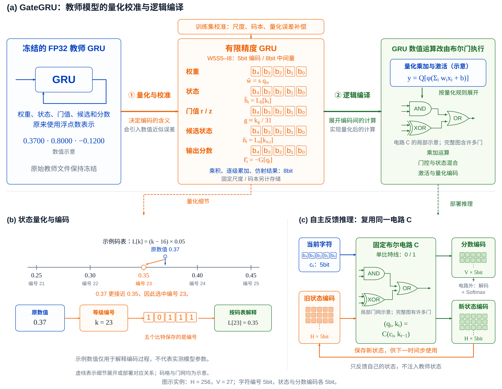
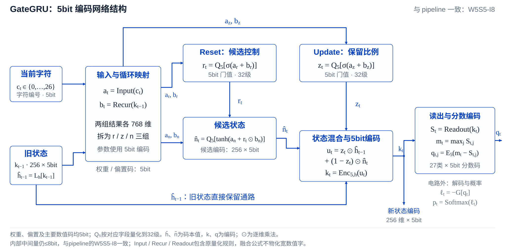

# GateGRU: A Quantized Recurrent Logic-Gate Network for Language Modeling

**GateGRU** 将 GRU 的门控、候选生成、状态更新和输出读出实现为固定二输入 Boolean 逻辑门网络。它逐个读入字符，更新内部状态，并输出下一字符的分数编码。

GateGRU 通过离线转换构建：冻结已训练的 GRU，通过训练集校准确定有限精度表示，再将量化后的计算展开为逻辑门电路。下文采用 **W5S5-I8** 设置：主要数值编码为5bit，内部物化中间数值字不超过8bit。

## GateGRU：量化校准与逻辑编译

转换包含两个阶段：

1. **量化与校准。** 仅使用训练数据确定固定尺度、状态与候选码本，并补偿部分量化误差。权重、偏置、状态、reset/update门值、候选和输出分数采用5bit编码；码本与固定尺度另计。
2. **逻辑编译。** 按有限精度规则，将乘加、比较、非线性映射、舍入和饱和展开为固定二输入单比特逻辑门。编译后门类型与连线固定，有限映射不作为不透明的运行时查表算子保留。

[查看可编辑 SVG](docs/figures/gategru-conversion-pipeline.svg)

5bit提供32种编码。对于状态，保存的是等级编号，数值含义由对应维度的码本确定；权重则结合固定尺度解释。量化确定编码的含义，逻辑编译实现这些编码之间的有限计算。

## GateGRU：5bit编码循环网络

下面展开固定电路内部的单步网络结构。输入映射与循环映射分别产生 reset、update 和 candidate 三组分支：

- **Reset重置门**调节候选分支中的循环仿射结果，采用 reset-after-affine 结构。
- **Update更新门**决定旧状态的保留比例，以及候选内容的写入比例。
- **候选状态与状态混合**形成新的记忆，并将混合结果重新编码为5bit状态。旧状态保留一条直接参与混合的通路。
- **输出读出**由新状态产生字符分数，计算各字符分数与最大分数的差，再编码为5bit。分数解码与 Softmax 位于电路外。

[查看可编辑 SVG](docs/figures/gategru-five-bit-network.svg)

图中 $c_t$ 表示当前字符编号，$k_t$ 表示状态编码，$q_t$ 表示输出分数编码。$\hat h_t$ 和 $\hat n_t$ 表示编码对应的状态与候选码本值；公式按这些代表值解释，编码编号不直接作为连续数值相加。`Input`、`Recur` 和 `Readout` 分别表示输入映射、循环映射和输出读出，并包含对应的量化规则。

## 数值边界与循环执行

| 对象 | W5S5-I8中的表示 |
|---|---|
| 权重、偏置、状态、门值、候选、输出 | 5bit编码 |
| 输入线性结果、乘积输出、每级树累加、循环与读出线性结果 | 不超过8bit |
| 输出最大值与分数差 | 8bit |
| carry、guard、sticky、overflow | 单比特控制信号 |
| 固定尺度、码本、指数与输出级别 | 单独记录的静态信息 |

非线性与状态混合可以在有限函数边界融合，再展开成单比特门；图中的功能公式不要求物化一个宽数值中间字。5bit编码也不等于全部存储都仅占每参数5bit，尺度和码本需要另计。

每个时间步复用同一套固定电路。电路接收当前字符与上一状态编码，产生输出分数编码和新状态编码；新状态保存后供下一步使用。循环过程反馈电路自身状态，部署时不需要教师状态注入。
